# Práctica 4. Gestión de ramas y resolución de conflictos

## 1. Creación del proyecto

Para empezar creé una carpeta llamada `webnova` y la inicialicé como repositorio Git, utilizando `main` como rama principal.

```bash
git config --global init.defaultBranch main
mkdir webnova
cd webnova
git init
```

Después creé `index.html` con el título y el párrafo iniciales que aparecían en el enunciado. Añadí el archivo e hice el primer commit:

```bash
git add .
git commit -m "C1: Versión inicial de WebNova"
```

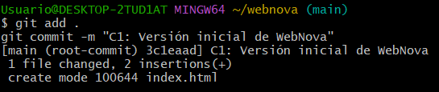

---

## 2. Trabajo con las tres ramas

El siguiente paso fue crear las ramas `cabecera`, `contenido` y `pie`, cada una para una parte distinta de la página.

```bash
git branch cabecera
git branch contenido
git branch pie
git branch
```

Con `git branch` pude comprobar que las tres existían y que seguía situado en `main`.

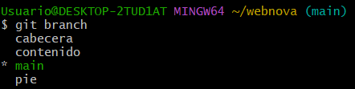

### Rama cabecera

Me cambié con `git switch cabecera`, creé `header.html` con el encabezado y el menú de navegación, e hice el commit C2.

```bash
git switch cabecera
git add header.html
git commit -m "C2: Añadido encabezado con navegación"
```

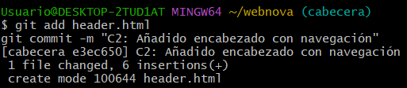

### Rama contenido

Después entré en `contenido`, creé `content.html` con la sección de servicios y guardé los cambios en C3.

```bash
git switch contenido
git add content.html
git commit -m "C3: Creado contenido principal"
```

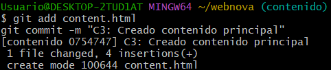

### Rama pie

Por último, trabajé en `pie`, donde creé `footer.html` y realicé el commit C4.

```bash
git switch pie
git add footer.html
git commit -m "C4: Añadido pie de página"
```

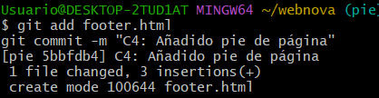

---

## 3. Fusión de las ramas

Cuando terminé las tres partes, volví a `main` y las fui fusionando una por una.

```bash
git switch main
git merge cabecera
git merge contenido
git merge pie
```

La primera fusión fue **Fast-Forward**, porque `main` no había avanzado por otro camino. En las dos siguientes Git tuvo que combinar historiales diferentes y creó commits de fusión, sin que apareciesen conflictos.

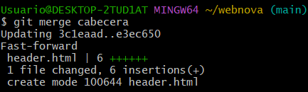

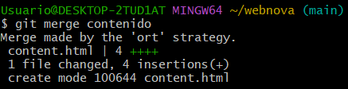

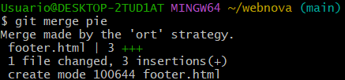

Después copié el contenido de `header.html`, `content.html` y `footer.html` dentro de `index.html` y lo guardé con el commit C5.

```bash
git commit -a -m "C5: Integrados cabecera, contenido y pie en index.html"
```

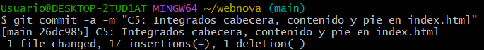

Como las tres ramas ya estaban integradas, las eliminé:

```bash
git branch -d cabecera contenido pie
git branch
```

Al comprobar las ramas, solo quedaba `main`.

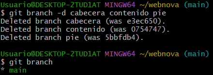

---

## 4. Crear un conflicto a propósito

Para esta parte creé la rama `rediseño` y cambié el `<h1>` de `index.html` por el título del rediseño. Guardé el cambio en C6.

```bash
git switch -c rediseño
git commit -a -m "C6: Rediseño del título principal"
```

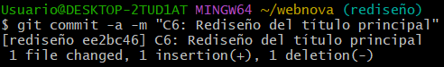

Después volví a `main` y modifiqué esa **misma línea**, pero con un título diferente. Ese cambio quedó en C7.

```bash
git switch main
git commit -a -m "C7: Cambio de título corporativo en main"
```

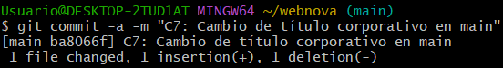

Al ejecutar `git merge rediseño`, Git no pudo decidir cuál de los dos títulos conservar. Al abrir `index.html` se veían las marcas de conflicto:

```text
<<<<<<< HEAD
<h1>WebNova - Portal principal corporativo</h1>
=======
<h1>WebNova - Sitio oficial (Rediseño 2026)</h1>
>>>>>>> rediseño
```

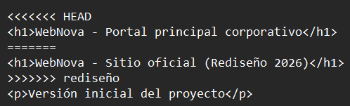

Para resolverlo quité esas marcas y dejé un único título que combinaba las dos versiones:

```html
<h1>WebNova - Portal principal (Rediseño 2026)</h1>
```

Después añadí el archivo y confirmé la resolución con C8:

```bash
git add index.html
git commit -m "C8: Conflicto resuelto entre main y rediseño en el H1"
```

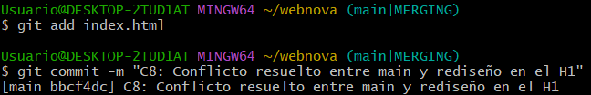

---

## 5. Historial final

Al terminar utilicé este comando para ver cómo habían quedado las ramas y las fusiones:

```bash
git log --oneline --graph --all
```

El gráfico muestra los tres desarrollos iniciales, sus fusiones en `main` y la separación entre C6 y C7 antes de resolver el conflicto con C8.

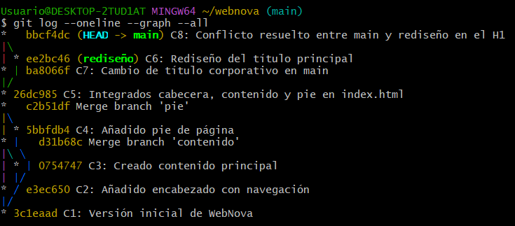

---

## 6. Preguntas de reflexión

### ¿Por qué ocurrió el conflicto en la Parte 3 y no en la Parte 2?

En la Parte 2 cada rama añadía un archivo distinto (`header.html`, `content.html` o `footer.html`), así que Git pudo juntarlos sin problema.

En cambio, en la Parte 3 modifiqué la misma línea `<h1>` de `index.html` de dos maneras diferentes: una en `main` y otra en `rediseño`. Git no podía saber cuál debía quedarse, por eso tuve que resolverlo manualmente.

### ¿Qué ocurrió con los archivos al ejecutar `git switch main` en la Parte 3?

Al volver a `main`, Git actualizó los archivos de la carpeta de trabajo a la versión guardada en esa rama. Por eso `index.html` dejó de mostrar el título del rediseño y volvió a tener el que había antes en `main`.

No perdí el cambio hecho en `rediseño`: seguía guardado en su commit, aunque ya no estuviera viendo esa versión en mi carpeta de trabajo.
